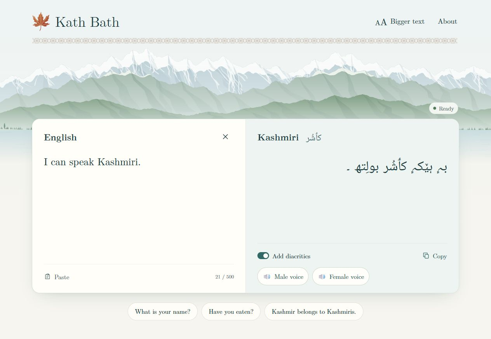

# Kath Bath

English → Kashmiri translation as you type, powered by **Koshur-Sarvam-4B — the best-performing English-to-Kashmiri translation model in our published comparison of open benchmarks**.

Our translator and diacritizer rank **first with a mean KATHE score of 14.91** across four public test sets, ahead of the evaluated KATHE 2026 competition systems, Microsoft Bing Translator, Claude Opus 5.5, GPT-6 Astra, and Gemini 3.1 Pro. The **4-bit version used by this website scores 14.90**, placing second in the same comparison. See the [Hugging Face leaderboard](https://huggingface.co/Jibby1729/Koshur-Sarvam-4B#6-comparison-with-other-models) for the full evaluation.



Type English to translate live, toggle diacritics, or listen in a male or female voice. Large text, a bigger-text option, and copy/paste controls keep the page easy to use. Kashmiri appears in Perso-Arabic script. Models run locally; no external inference API or browser API key is needed.

Made by [Jibran Iqbal Shah](https://jibby1729.github.io/), inspired by the [KATHE AI 2026 contest](https://www.kaggle.com/competitions/kathe-2026). Translation uses [Koshur-Sarvam-4B](https://huggingface.co/Jibby1729/Koshur-Sarvam-4B); diacritics use [Koshur-JibDiacritizer-152M](https://huggingface.co/Jibby1729/Koshur-JibDiacritizer-152M). Voices use [Bolbosh](https://github.com/gaash-lab/Bolbosh), made by [Gaash Lab](https://gaash.nitsri.ac.in/) at NIT Srinagar.

## Benchmark results

[](https://huggingface.co/Jibby1729/Koshur-Sarvam-4B#6-comparison-with-other-models)

The model card's plot shows the top five systems. **Its vertical axis starts at 12**, so bar heights are not proportional to the scores.

### Top 10

Ranked by mean KATHE score across **IN22-Conv, IN22-Gen, SMOL, and FLORES-200 devtest: 4,402 sentences**. Higher is better. Each test-set cell is **no-diacritic BLEU / KATHE score**; KATHE combines marked BLEU and chrF++ using their geometric mean. These are our evaluations on public test sets, not official Kaggle blind-test scores.

| Rank | System | KATHE score (mean) | VRAM | IN22-Conv | IN22-Gen | SMOL | FLORES |
|---:|---|---:|---:|---:|---:|---:|---:|
| 1 | **Our model: Sarvam 4B + Kashmiri-only restorer** | **14.91** | **8.4 GB** | **21.39 / 17.67** | **21.91 / 19.21** | **5.20 / 6.68** | **17.54 / 16.09** |
| 2 | **Our model, 4-bit: Sarvam 4B NF4 + Kashmiri-only restorer** | **14.90** | **3.5 GB** | 20.96 / 17.37 | 21.63 / 19.24 | 5.19 / 6.65 | 17.96 / 16.34 |
| 3 | [Noore: IndicTrans2 200M + restorer](https://huggingface.co/Aju360/kathe-r12-200m-selected), Kaggle #9 | 13.92 | 1.1 GB | 18.82 / 15.55 | 19.89 / 18.01 | 5.18 / 6.12 | 17.13 / 16.01 |
| 4 | [TeamHD: NLLB 1.3B + 3.3B reranking](https://github.com/saliq-2/Final_submission_KATHE2026), Kaggle #1 [X] | 13.79 | 9.2 GB | 19.90 / 14.42 | 21.20 / 18.28 | 5.11 / 5.71 | 18.35 / 16.73 [X] |
| 5 | Microsoft Bing Translator | 13.62 | N/A | 17.36 / 14.97 | 19.57 / 17.66 | 5.02 / 6.40 | 16.45 / 15.46 |
| 6 | [Kathe Bathe: Sarvam 4B LoRA](https://huggingface.co/KatheBathe/Kathe-Bathe), Kaggle #4 | 13.19 | 8.6 GB | 19.46 / 14.28 | 18.65 / 16.92 | 4.92 / 5.98 | 16.56 / 15.60 |
| 7 | [Sarvam-Translate 4B](https://huggingface.co/sarvamai/sarvam-translate), untouched | 12.90 | 8.6 GB | 17.82 / 13.49 | 19.90 / 18.00 | 4.60 / 5.56 | 15.55 / 14.57 |
| 8 | [Bodhan ~8B](https://huggingface.co/bodhan-ai/indic-translate), untouched | 12.77 | 15.9 GB | 16.26 / 13.60 | 18.69 / 17.87 | 4.57 / 5.84 | 14.22 / 13.78 |
| 9 | [Team IT: IndicTrans2 1B](https://huggingface.co/maliktafheem/kathe-2026-en-kas-arab-1b), Kaggle #11 | 12.26 | 4.5 GB | 18.74 / 13.78 | 16.33 / 14.01 | 5.01 / 5.80 | 16.03 / 15.44 |
| 10 | [kav: NLLB 1.3B LoRA](https://huggingface.co/aymanmakroo/kav), Kaggle #2 | 11.49 | 2.8 GB | 13.67 / 12.22 | 15.47 / 15.70 | 4.00 / 4.87 | 13.55 / 13.19 |

### Frontier model comparisons

These three additional models retain their ranks from the full leaderboard.

| Rank | System | KATHE score (mean) | VRAM | IN22-Conv | IN22-Gen | SMOL | FLORES |
|---:|---|---:|---:|---:|---:|---:|---:|
| 13 | Claude Opus 5.5 | 10.70 | N/A | 14.78 / 12.83 | 14.06 / 14.48 | 3.43 / 4.61 | 10.64 / 10.88 |
| 15 | GPT-6 Astra | 9.58 | N/A | 13.75 / 11.24 | 13.29 / 13.63 | 3.25 / 3.91 | 9.53 / 9.55 |
| 16 | Gemini 3.1 Pro | 9.14 | N/A | 14.49 / 10.63 | 14.44 / 13.58 | 3.92 / 3.93 | 10.42 / 8.41 |

Source: [published model-card comparison](https://huggingface.co/Jibby1729/Koshur-Sarvam-4B/blob/69b1a92f40ba83e7b763471c6169b0b8252062fc/README.md#6-comparison-with-other-models), checked October 21, 2026. VRAM figures follow the model card's measurement conventions and are not the website's total runtime memory requirement. **[X]** marks TeamHD's FLORES result: the model card reports that 603 of its 1,012 English test sources occur in that system's released training data. Frontier model names are the evaluated API endpoint labels. A fresh blind evaluation is still needed; benchmark leadership does not guarantee every translation is correct.

## Run locally (Windows + NVIDIA GPU)

The tested environment is **Windows, Python 3.13, an RTX 4060 Laptop GPU (8 GB), and CUDA 12.8 PyTorch**. Allow at least 15 GB of free disk space for the translator, with additional room for the separate speech environment. The translator runs in **4-bit NF4** on the GPU; the 152M diacritizer runs on CPU. First startup downloads about 8.4 GB of weights plus tokenizer files. Later starts reuse the cache. Native acceleration additionally needs the CUDA Toolkit and Visual Studio C++ tools; a fallback is available when they are absent.

```powershell
python -m venv .venv
.\.venv\Scripts\python.exe -m pip install torch --index-url https://download.pytorch.org/whl/cu128
.\.venv\Scripts\python.exe -m pip install -r requirements.txt
.\start.ps1
```

Open **http://127.0.0.1:8000**. After installation, double-click `start.cmd` to launch again. Keep that terminal open while using the page. Stop with Ctrl+C. `start.ps1 -Port 8001` selects another port.

Wait for **Ready**, then type English. Input processing starts at word boundaries or after a 120 ms gap; translation starts after a 250 ms pause. `Ctrl+Enter` translates immediately. Follow the CPU voices setup below to enable speech.

`requirements-lock.txt` records the exact Windows/CUDA environment used for verification (including test dependencies). To reproduce it, use `pip install -r requirements-lock.txt --extra-index-url https://download.pytorch.org/whl/cu128` inside the environment.

For UI work without downloading or loading models:

```powershell
.\start.ps1 -Preview
```

### Enable CPU voices

Install Bolbosh in a separate environment:

```powershell
python -m venv .venv-tts
.\.venv-tts\Scripts\python.exe -m pip install -r requirements-tts.txt
.\.venv\Scripts\python.exe scripts/setup_bolbosh.py
```

Restart `start.cmd` after setup. Both voices run in a separate CPU-only process, with no GPU memory use. Model downloads total about 307 MB. `requirements-tts-lock.txt` records the tested environment; use `--extra-index-url https://download.pytorch.org/whl/cpu` when installing it. Upstream source licenses and notices are retained in `vendor/bolbosh/`.

## API

- `GET /api/health`: `{ "state": "starting|downloading|loading|ready|error|offline", "message": "…" }`.
- `POST /api/translate` with `{ "text": "How are you?", "session_id": "page-uuid" }`: `{ "translation": "…", "draft": "…", "elapsed_seconds": 1.23, "cached": false, "timings": { ... } }`. `session_id` is optional; timings include generation, restoration, first decoding step, and reused prompt token count.
- `POST /api/prefill` with the same body and a required `session_id`: prepares the complete four-beam prompt for exact-input reuse. Returns `prefilled: false` when inference is busy; this speculative request never queues ahead of translation.
- `POST /api/speech` with `{ "text": "کٲشُر", "voice": "male" }` (or `female`): mono 22,050 Hz PCM WAV; max 1,500 characters, 429 when speech is busy. Speech failures do not discard the translation.
- 422 for invalid input/incomplete output, 503 while unavailable, 429 when the inference queue is full. Model startup and inference failures appear in the server terminal.

FastAPI serves the page and API from the same origin. No browser API keys or external inference service. Typed text goes to the local server and remains in its in-memory cache until eviction/restart; the application does not write passages to a database, local storage, or access logs. Only the bigger-text preference is stored in the browser. Hugging Face is contacted to download model files. Model caches and environments are ignored by Git.

The service binds to **127.0.0.1** by default. Optional laptop sharing uses the
included bounded gateway. Serving the static files alone cannot run the
models. Use one Uvicorn model worker per GPU to avoid loading duplicate copies.
No paid infrastructure is provisioned by this project. A standard CPU VPS alone
cannot run this application's CUDA translator.

Cloud migration is not yet implemented or benchmarked. The fastest native decoder is currently specific to **Windows/Ada GPUs**; moving to Linux or another GPU requires choosing the compatible path and repeating output-equality and latency tests. Cold-starting a cloud model also adds loading time. Keep four-beam decoding and the CPU diacritizer when comparing deployments.

## Repository layout

| Path | Contents |
| --- | --- |
| `web/` | Page, styles, translation and audio controls, local font |
| `app/` | FastAPI API, model pipeline, bounded caches and CPU speech worker |
| `app/kernels/` | Native NF4 decoder source |
| `vendor/bolbosh/` | Pinned inference sources and upstream license notices |
| `tests/` | Backend and JavaScript regression checks |
| `scripts/` | Setup, reproducible comparisons, and earlier experimental benchmarks |
| `INFERENCE_NOTES.md` | Optimization history, accepted/rejected paths and measurements |

Experimental scripts are not used by the web application. `.venv/`, `.venv-tts/`, `.model-cache/`, `artifacts/`, credentials and compiled binaries are excluded from Git. Model weights download during setup rather than being committed.

## Attribution

The translator weights inherit **GPL-3.0 and the Gemma terms**; the diacritizer and its loader are **Apache-2.0**. See the linked model repositories for their licenses and notices. Model weights are downloaded from those repositories, not redistributed here. Noto Naskh Arabic is bundled under the [SIL Open Font License](web/fonts/OFL.txt), from [Google Fonts](https://fonts.google.com/noto/specimen/Noto+Naskh+Arabic).
